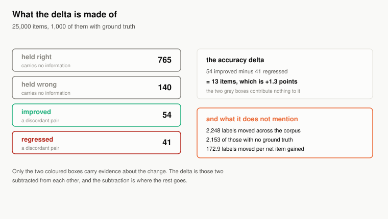
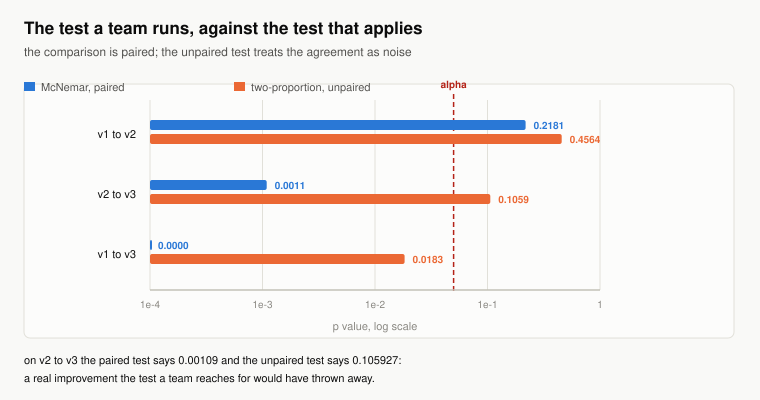
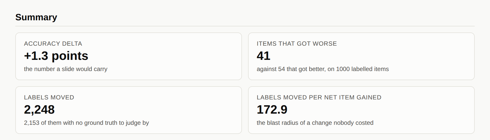
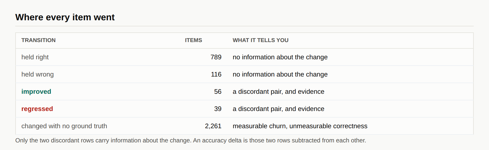
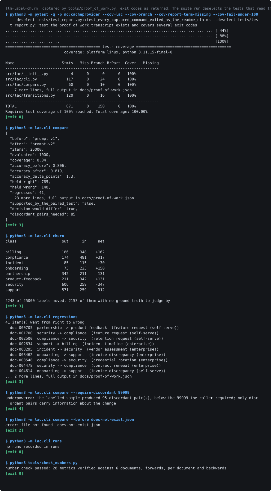

# llm-label-churn

[](https://github.com/Sruthi0510-data/llm-label-churn/actions/workflows/ci.yml)
[](https://www.python.org/)
[](#quickstart)
[](LICENSE)

**Shows what an accuracy delta hides when you change an LLM labelling prompt: which items the change broke, how many labels moved that nobody can judge, and whether the improvement is distinguishable from noise by the test that actually applies.**

## The question an accuracy delta cannot answer

Accuracy is a marginal. Two versions labelling the same corpus can agree on it exactly while disagreeing about a tenth of the items, and a change that raises it by a point can be made entirely of items that got worse cancelling items that got better. The subtraction destroys the only distinction anyone acts on.

Four questions this answers that a delta structurally cannot:

1. Which items got worse. Not how many net: which, with the text, so a human can look at them before shipping.
2. How many labels moved across the whole corpus, against how many items were actually gained.
3. How many of those moves nobody is in a position to judge, because ground truth covers a sample and the pipeline labels everything.
4. Whether the change is distinguishable from noise by the paired test this design calls for, rather than the unpaired one a team reaches for.

## The uncomfortable numbers

The shipped corpus holds 25,000 items, and 1,000 of them have a human label, which is 4.0% of the corpus. Comparing the first prompt to the second:

- Accuracy goes **up 1.3 points**. On that number alone the change ships.
- **41 items got worse**, against 54 that got better, for a **net gain of 13 items**. The 765 items both versions got right and the 140 both got wrong contribute nothing to the delta and make up most of the evaluation set.
- **2,248 labels moved** across the corpus. **2,153 of those moves** have no ground truth behind them: measurable churn, unmeasurable correctness. That is **172.9 moved for every** net item gained.
- **The paired test returns 0.2181**, and **the unpaired test returns 0.4564**. The change is not distinguishable from noise, and the delta said ship.

Then the opposite failure, on the next version. Moving from the second prompt to the third is **worth 2.7 points**, **the paired test says 0.0011** and **the unpaired test says 0.1059**. A real improvement, which the test most teams run would have thrown away.

210 tests, 100.0% line and 100.0% branch coverage, and every figure on this page is re-measured by CI and matched against the wording around it by `tools/check_numbers.py`.

## Quickstart

Requires Python 3.11 or newer and nothing else. No model, no API key, no tracking server, no network.

```bash
git clone https://github.com/Sruthi0510-data/llm-label-churn.git
cd llm-label-churn
pip install -e ".[dev]"

# the headline
lac compare --before fixtures/prompt-v1.json --after fixtures/prompt-v2.json

# the items a human should look at before shipping
lac regressions

# where the labels went, by class
lac churn

# re-measure everything on this page and fail if a sentence has gone stale
make verify
```



## Only two of the four boxes carry evidence

An item that both versions got right tells you nothing about the change. Nor does one both got wrong. The delta is the other two subtracted from each other, and the paired test uses exactly those, which is why the sample size that matters is not the number of labelled items but the number of discordant pairs among them.

<!-- table:changes generated by tools/render_tables.py from exp02_the_wrong_test.json -->
| change | accuracy delta | discordant pairs | paired p | unpaired p | tests disagree |
| --- | --- | --- | --- | --- | --- |
| `prompt-v1` to `prompt-v2` | +1.3 points | 95 | 0.2181 | 0.4564 | no |
| `prompt-v2` to `prompt-v3` | +2.7 points | 65 | 0.0011 | 0.1059 | yes |
| `prompt-v1` to `prompt-v3` | +4.0 points | 74 | 0.0000 | 0.0183 | no |
<!-- /table:changes -->



The comparison is paired: every item was labelled by both versions. The two-proportion z test assumes two independent samples, so it treats all the agreement between the versions as noise, and its standard error is far larger than the design deserves. It therefore loses power, and on the middle row it loses enough to discard a real improvement. ADR-002 has the derivation and the alternatives.

## The population nobody can evaluate

Ground truth covers a sample; the pipeline labels everything. Churn needs only two label sets, so it is measurable on the whole corpus. Correctness needs a human, so it is measurable only where one looked.

<!-- table:coverage generated by tools/render_tables.py from exp03_the_unevaluable_majority.json -->
| coverage | labelled items | discordant pairs | label moves nobody can judge | paired p |
| --- | --- | --- | --- | --- |
| 0.2% | 50 | 7 | 2,241 | 1.0000 |
| 1.0% | 250 | 25 | 2,223 | 0.6900 |
| 4.0% | 1,000 | 95 | 2,153 | 0.2180 |
| 10.0% | 2,500 | 214 | 2,034 | 0.0165 |
| 25.0% | 6,250 | 544 | 1,704 | 0.0040 |
| 50.0% | 12,500 | 1133 | 1,115 | 0.0007 |
<!-- /table:coverage -->

The paired test first **resolves at 10.0% coverage**. Annotating that much buys statistical confidence about the sample, and at half coverage there are **still 1,115 moves** with no ground truth behind them. A larger labelled sample buys confidence; it does not buy sight of the corpus, and reporting a sample-sized number as though it described the corpus is the second failure this repository is about.

## How large an evaluation set has to be

Only discordant pairs carry information, and this corpus produces them at a **discordant rate of 9.5%** of labelled items. So the sizing question is not "how many items should we annotate" but "how many disagreements do we need", and the conversion between them is the number nobody computes.

<!-- table:sizing generated by tools/render_tables.py from exp04_how_big_an_eval_set.json -->
| improvements among the flips | discordant pairs needed | items to label | multiple of the current set |
| --- | --- | --- | --- |
| 55% | 783 | 8,242 | 8.2x |
| 60% | 194 | 2,042 | 2.0x |
| 65% | 85 | 895 | 0.9x |
| 70% | 47 | 495 | 0.5x |
| 80% | 20 | 211 | 0.2x |
<!-- /table:sizing -->

Resolving a change where six flips in ten are improvements **needs 194 discordant pairs**, which is **2,042 labelled items, which** is **2.0 times the current** set. A change subtler than that is out of reach of any evaluation set this team is going to build, and that is worth knowing before the prompt is written rather than after.

## Where the labels actually went

A net change of thirteen items can sit on top of a taxonomy-wide reallocation. On this corpus **the security class** **shifts by -347 labels** across twenty-five thousand documents. Every downstream filter, dashboard and join keyed on that class sees the reallocation. The accuracy delta does not mention it, and neither does any evaluation harness that reports a single number.

## The bugs the measurement found

**A generator that inverted its own result.** The first construction mixed a shared item difficulty with per-version noise as a weighted average. That controlled the correlation between the versions and quietly changed the variance of the score, so raising the correlation lowered the accuracy of a version whose skill had gone up. The repository would have argued the opposite of what it meant to. Each version now redraws the shared difficulty for a small share of items, which sets the correlation and leaves the marginal exactly where it was.

**A coverage sweep that fabricated its own ground truth.** The experiment that sweeps annotation coverage extended the shipped ground truth using the earlier version's own labels where truth was missing. That made the earlier version correct by construction on every added item and biased the comparison against the change under test. It regenerates the corpus at each coverage now, which is only valid because the ground truth sample is drawn from a separate random stream: raising the coverage changes which items a human looked at and changes nothing else.

**Two branches that could not be reached.** Branch coverage found an upper-tail path in the binomial helper that no caller uses, because the caller always takes the smaller of the two counts, and a zero-trials guard that cannot fire because the function above it returns first. A branch nothing can reach is not defensive, it is a claim the tests cannot check. It also found `Corpus.by_id` unused, which turned into better output: the regression list prints the item text now, so a reviewer can judge without opening the corpus.

## Evidence

The report below is the tool's own HTML output. `tools/capture_screenshots.py` builds it if missing, frames each shot by heading, and reads the verdict badge's computed style back out of the rendered page so an illegible headline fails the run.





## What this repository cannot measure

Its own section, because it is the most important one.

- **The corpus is generated.** The rates are a demonstration that the phenomenon has a size, not a prediction about yours. The generator's knobs are documented so a reader can set their own class skills and re-measure in one command.
- **No model is called.** The label sets are the input. This tool does not evaluate a prompt, it evaluates a comparison between two sets of labels, and it has no opinion about why they differ.
- **Ground truth is assumed correct.** Every transition is defined against it. A mislabelled item is classified confidently and wrongly, and an annotation quality pass is a different tool.
- **The unjudgeable population is counted, never assessed.** The repository reports how many labels moved with no ground truth behind them. It cannot say whether those moves were improvements, and the honest position is that neither can anybody else.
- **Statistical significance is not importance.** A change can be highly significant and worthless: the paired test answers whether the improvement is real, not whether thirteen items justify moving two thousand labels. The churn-per-gain figure exists because the test cannot answer that question.

## Layout, exit codes and reproduction

```
src/lac/
  labels.py       items, label sets, and ground truth kept partial
  transitions.py  the per-item accounting a delta sums away
  stats.py        McNemar exact, the unpaired test, Wilson intervals
  compare.py      one comparison, both tests, and a verdict
  runs.py         a file-backed run log in a tracker's shape
  generator.py    the seeded corpus and three prompt versions
  report.py       the self-contained HTML report
experiments/      five experiments, each writing JSON to docs/experiments/
docs/adr/         five architecture decision records
```

| code | meaning |
| --- | --- |
| 0 | the comparison ran and no item went from right to wrong |
| 3 | the comparison ran and found regressed items. This is the tool working |
| 2 | the tool could not answer: bad arguments, unreadable label set, mismatched items |
| 4 | the labelled sample cannot support the guarantee the caller asked for |

```
make lint       ruff over src, tests, tools and experiments
make test       pytest with junit and coverage reports
make receipts   re-measure every published figure and check it against the prose
make verify     all of the above, offline, from a fresh clone
```

`tools/check_numbers.py` matches anchor phrases rather than digits, collapses whitespace so a wrapped line cannot fail correct prose, checks each document separately so a stale sentence cannot hide behind a correct one, and checks backwards so a number nothing re-measures cannot appear. The data tables are not typed at all: `tools/render_tables.py` writes them from the experiment JSON and CI fails if the committed README differs from a fresh render.

## Proof of work

The transcript below was produced by running the commands, not by transcribing
them. `tools/proof_of_work.py` executes each one in a subprocess, records the
exit code, and fails the build when a command does not exit the way this README
says it does, so all four documented exit codes are demonstrated rather than asserted. Elapsed times and absolute paths are normalised so the
committed image does not change on every run; nothing else is touched, and the
full untruncated output with a SHA-256 of each command's bytes is in
`docs/proof-of-work.json`.



## Tech stack

| technology | role here | why this one |
| --- | --- | --- |
| Python, standard library only | the accounting, both tests, the generator | the core is set membership and two closed forms; a statistics dependency would hide the derivation the README is arguing |
| an exact binomial, in log space | McNemar's test | the normal approximation to McNemar is unreliable at the discordant counts a real evaluation set produces, which is exactly where the answer matters |
| a file-backed run log | recording each comparison | a directory of JSON in a tracker's shape, so a reviewer needs no server, and an optional `mlflow` extra mirrors the same fields for a team that has one |
| pytest with branch coverage | 210 tests, at 100.0% line and 100.0% branch | branch coverage is what matters in a module of classification rules, and it found two unreachable paths |
| ruff | lint and import order | one tool over source, tests, tooling and experiments, so the experiments cannot drift into scratch code |
| Playwright with Chromium | asserting the committed SVGs load, reading badge contrast | only a browser sees a `naturalWidth` of zero or a badge rendered in its own background colour |
| hand-emitted SVG | both diagrams | avoids four Mermaid failure modes that all land on a README embed. See ADR-005 |

## Architecture decision records

- ADR-001: ground truth is partial and stays partial
- ADR-002: the comparison is paired, and the usual test is not
- ADR-003: a run log without a tracker
- ADR-004: exit codes separate a finding from a failure
- ADR-005: what this repository cannot measure, and what it would take

## The Pivot

The tool reports the regressed items and does not triage them. It will tell you which items went from right to wrong, print their text, and export them as a run artifact, and it will not rank them by importance. Ranking needs to know what each label is used for downstream, which is a question about somebody's warehouse rather than about the labels, and a tool that guessed it would be trusted for a judgement it cannot make. The trigger for building it: a lineage graph from label to consumer, which makes the ranking a lookup rather than a guess.

## Future work

- Per-segment breakdowns, so a change that helps enterprise accounts and hurts self-serve is visible rather than averaged. First metric to watch: whether any segment's net change has the opposite sign to the corpus.
- A sequential test, so a team can stop annotating as soon as the discordant pairs settle the question rather than annotating a number chosen in advance.
- Confidence intervals on the churn figures themselves, which are currently point estimates over the whole corpus and deserve the same treatment the accuracy figures get.
- An agreement model for the unjudgeable population: if two independent annotators disagree at a known rate, the size of the unevaluable population can be priced rather than only counted.

## Licence

MIT. See `LICENSE`.
